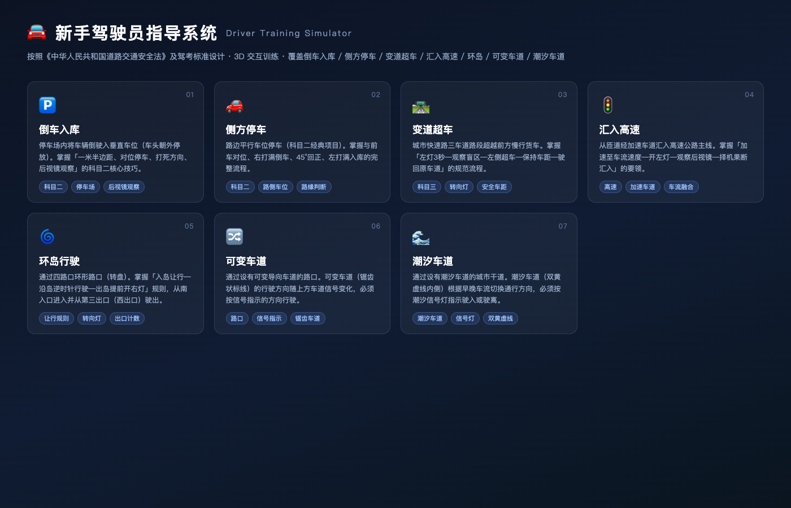
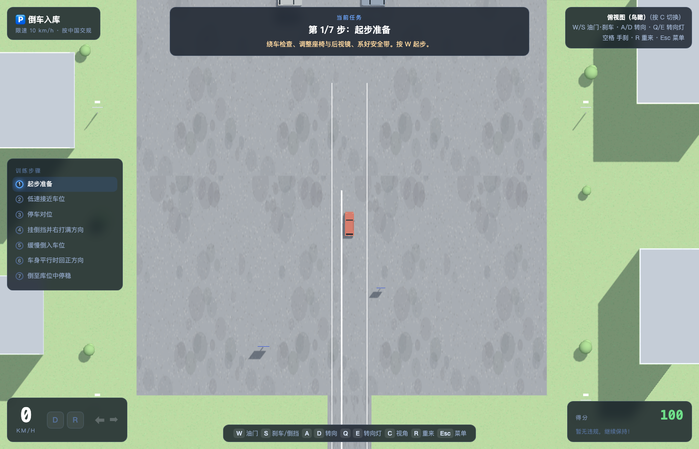
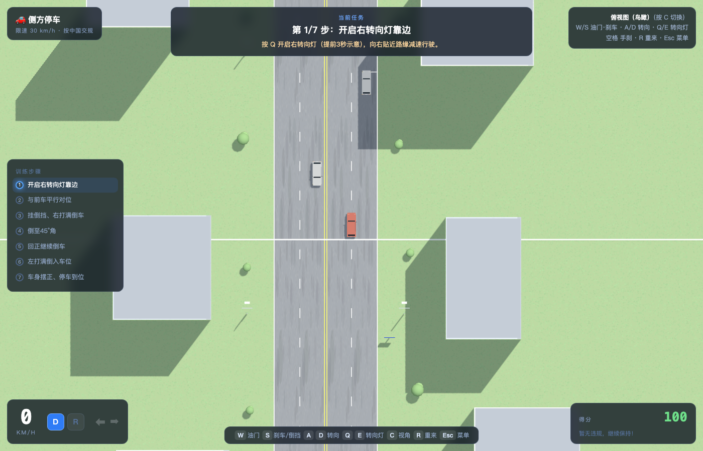
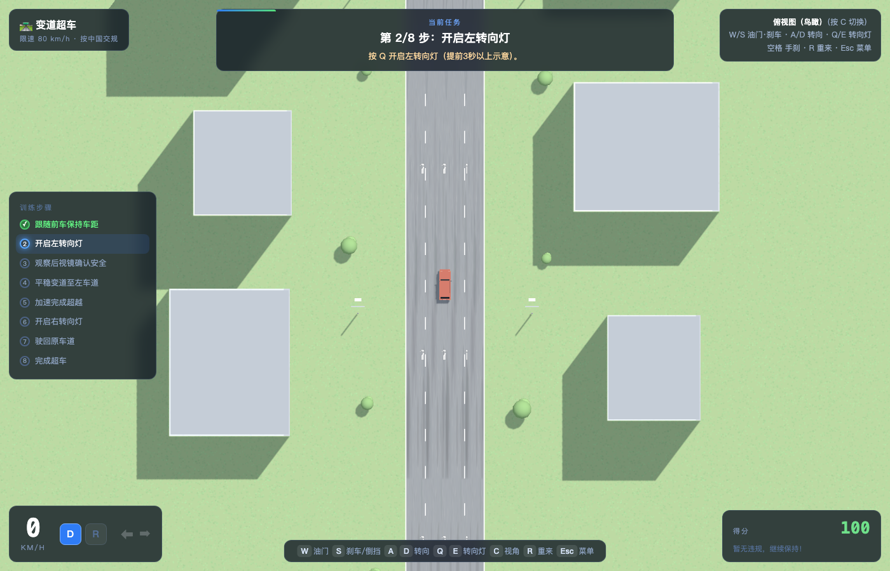
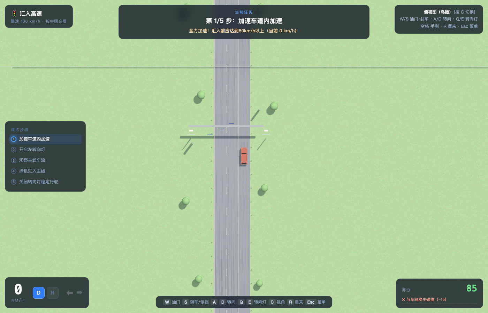
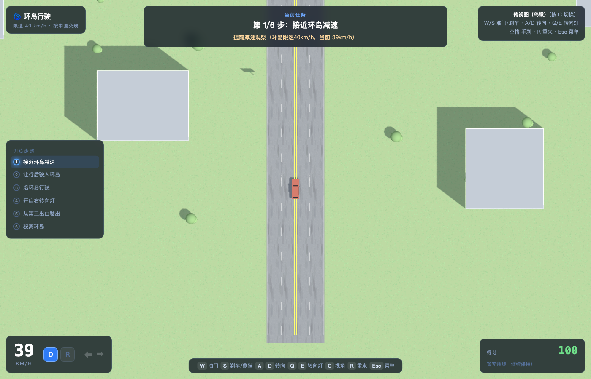
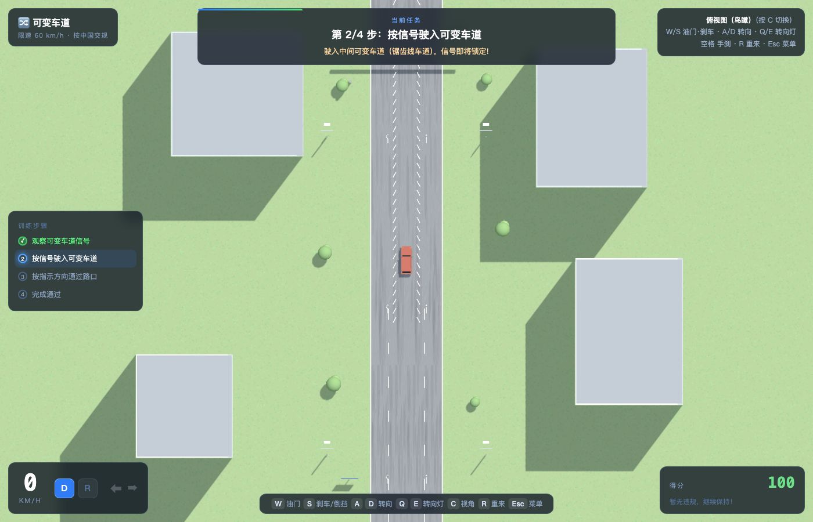
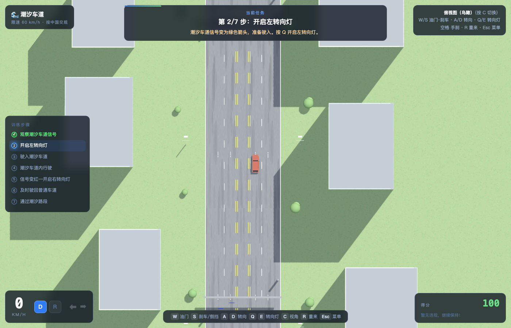

# 🚗 新手驾驶员指导系统（Novice Driver Training Simulator）

基于 **Three.js** 的 3D 驾驶训练模拟器，严格按照《中华人民共和国道路交通安全法》与驾考标准设计，
帮助新手驾驶员在虚拟环境中练习 7 个高频真实驾驶场景。

**🎮 在线体验：<https://xiaoxfan.github.io/novice-driver-guide/>**（推荐 Chrome / Edge，无需安装）



## ✨ 功能特性

### 七大训练场景

| 场景 | 训练要点 |
| --- | --- |
| 🅿️ **倒车入库** | 车位对位、右打满倒车、45° 回正、库内停车不压线 |
| 🛣️ **侧方停车** | 与前车平行对位、45° 倒车入库、车身回正、安全驶出 |
| 🚙 **变道超车** | 转向灯 3 秒、观察后视镜、借道超车、安全返回（保持车距） |
| 🛤️ **汇入高速** | 加速车道提速、寻找空隙、打灯汇入主路 |
| 🌀 **环岛行驶** | 入岛让行（让已在环岛内车辆先行）、逆时针绕行、出口前开右灯 |
| ↔️ **可变车道** | 识别锯齿线可变车道、按信号灯指示方向（左转/直行）通过 |
| 🌊 **潮汐车道** | 识别潮汐车道信号灯、按规定时段借道行驶、及时驶回 |

### 核心系统

- **3D 逼真场景**：真实比例道路（车道 3.5m）、国标标线（双黄线、导流线、鱼骨线、让行标线）、
  国标标志牌、信号灯（可变车道指示器 / 潮汐车道红绿箭头）、建筑、树木、路灯、护栏等
- **拟真车辆物理**：自行车模型转向几何、D/R/N 挡位、油门/刹车/手刹、自动回正转向灯
- **三种视角**：追尾视角（默认）、**俯视图**（按 `C` 切换，观察全局更直观）、引擎盖视角
- **分步引导教学**：每个场景 4–8 个步骤，实时提示当前操作要领
- **交规违规判定**：压实线、碰撞障碍物/车辆/锥桶、驶出路面、超速、不打转向灯变道、
  环岛不让行等，扣分并红屏警示，附违规清单
- **智能 AI 交通**：社会车辆按路径行驶，具备**同向跟车避撞**能力（遇前方拥堵自动减速排队）
- **音效反馈**：WebAudio 合成引擎声、提示音、碰撞音

## 🚀 快速开始

无需构建，直接用浏览器打开即可（推荐 Chrome / Edge）：

```bash
# 本地启动（任选其一）
open index.html
python3 -m http.server 8000   # 然后访问 http://localhost:8000
```

## 🎮 操作说明

| 按键 | 功能 |
| --- | --- |
| `W` / `S` | 油门 / 刹车（停稳后**长按 S 挂倒挡 R**） |
| `A` / `D` | 左转 / 右转 |
| `Q` / `E` | 左 / 右转向灯（变道、转弯、出环岛必备） |
| `空格` | 手刹 |
| `C` | 切换视角（追尾 → 俯视 → 引擎盖） |
| `R` | 重新开始当前场景 |
| `Esc` | 返回菜单 |

## 🧪 自动化测试

`test.html` 提供无渲染的逻辑自检：为 7 个场景分别内置自动驾驶脚本，
验证分步引导可完成、场景几何正确、违规零误判：

```bash
# 用 Chrome 打开，控制台输出结果
open test.html
# 或无头运行
"/Applications/Google Chrome.app/Contents/MacOS/Google Chrome" \
  --headless=new --disable-gpu --virtual-time-budget=60000 \
  --dump-dom "file://$(pwd)/test.html" 2>&1 | grep TEST
```

全部场景自动化验证结果：**7/7 通过，0 违规误判**。

## 📁 目录结构

```
├── index.html        # 主入口（菜单 + 游戏）
├── test.html         # 无渲染逻辑自检（自动驾驶脚本）
├── css/style.css     # UI 样式
├── js/
│   ├── lib/three.min.js   # Three.js r128
│   ├── util.js            # 数学工具 / 纹理生成 / 世界构建器 / 违规检测
│   ├── car.js             # 车辆模型 / 物理引擎 / AI 跟车避撞
│   ├── scenarios.js       # 7 个场景定义（标线/标志/步骤/规则/判定）
│   └── main.js            # 渲染循环 / 相机 / HUD / 输入 / 流程控制
└── docs/             # 场景截图
```

## 📸 场景预览

| 倒车入库 | 侧方停车 |
| --- | --- |
|  |  |

| 变道超车 | 汇入高速 |
| --- | --- |
|  |  |

| 环岛行驶 | 可变车道 |
| --- | --- |
|  |  |

| 潮汐车道 | |
| --- | --- |
|  | |

## ⚠️ 免责声明

本系统仅供驾驶学习参考，规则表述以现行法律法规及当地交管部门规定为准。
实际驾驶请以教练指导和真实路况为准。

## 📄 License

MIT
